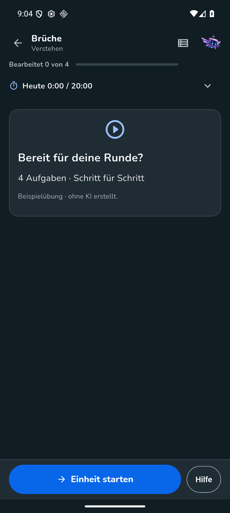

# Android: echte Fertigmeldung zu einer Demo-Lernrunde

Am 5. November 2026 wurde auf dem eigenen Emulator `emulator-5580` gegen den produktiven Server ein eng begrenzter Test mit einer eigens angelegten und ausdrücklich synthetischen Familie durchgeführt. Eine zeitlich begrenzte Push-Testfreigabe für Eltern- und Kinderkonto sowie die reguläre Betreiberfreigabe waren vorhanden. Es wurden keine echten Kinderdaten verwendet und keine Antwort abgegeben. Die Demo-Runde wurde lokal deterministisch erzeugt; dieser Test belegt keinen externen KI-Aufruf.

Server: Commit `db24444734053d9a1b733f4f68c9ddc68b1d0685`, Version `1.38.89+244`. Der Emulator erhielt das Direct-APK-Update regulär über die App und die Android-Installationsbestätigung. Die App meldete die erfolgreiche Prüfung von Größe, SHA-256, Paket, Version und Signatur; der SHA-256 der tatsächlich installierten APK stimmte anschließend mit dem aktiven Release-Manifest überein.

## Beobachtung

- Das Kind aktivierte die Benachrichtigung auf dem Emulator selbst. Zuvor waren Elternfreigabe und der begrenzte Testgrant geprüft; das Gerät wurde einer gültigen eigenen Sitzung zugeordnet. Seine Ruhezeit wurde für den Test auf `00:00–00:00` gesetzt.
- Vor der Anforderung bestanden für das künstliche Kind keine Lernrunden; für das frisch registrierte Gerät bestanden keine Zustellungen und weder aktuell noch für die folgenden zehn Minuten andere fällige Benachrichtigungskategorien. Andere zuvor angezeigte App-Benachrichtigungen waren ausgeschlossen.
- Die Android-Activity war nachweislich im Hintergrund und gestoppt. Danach wurde **genau ein** regulärer Auftrag für die einzelne bestätigte feste Demo-Heftseite erteilt. Es erfolgte kein Wiederholungsauftrag und kein Provideraufruf.
- Der Auftrag speicherte genau eine Runde. Für das neue Gerät gab es genau einen passenden `round_ready`-Zustelldatensatz; FCM nahm ihn an. Eine Android-Systembenachrichtigung mit neutralem Text wurde im Benachrichtigungsbereich tatsächlich gesehen. Die Identität des Datensatzes und das Fehlen anderer Zustellungen wurden unmittelbar vor dem Tippen erneut geprüft.
- Der Tipp öffnete die Detailansicht „Brüche“ mit „Einheit starten“. Da dies die einzige Runde des Kontos war und der serverseitige Fertigbeleg auf genau diese Einheit zeigte, ist das Ziel der beobachteten Meldung zugeordnet. Die Runde wurde nicht gestartet und keine Antwort eingetragen.

## Bereinigung und Grenzen

Die automatisierte UI-Bereinigung erreichte nach dem Rückweg aus der tief verlinkten Ansicht nicht die Abmeldung. Der [unveränderte Rohbericht](evidence/android-demo-ready-2026-11-05.raw.json) hielt dies als `cleanup_ui_incomplete=true` und `app_logged_out=false` fest; das Gerät war über die autorisierte API bereits entfernt. Anschließend wurde die App regulär erneut geöffnet, über „Konto öffnen“ → „Abmelden“ abgemeldet und „Willkommen zurück“ sichtbar geprüft. Die autorisierte Eltern-API löschte danach die eindeutig zugeordnete synthetische Familie; die temporäre Zugangsdaten-Datei wurde entfernt. Der [separate Bereinigungsnachweis](evidence/android-demo-ready-2026-11-05.cleanup.json) hält diese Nacharbeit fest. Der Testhelfer versucht die Abmeldung künftig unabhängig vom Ergebnis der UI-Geräteentfernung; diese Anpassung wurde nicht durch eine weitere Push-Sendung geprüft.

Belegt sind der eine Hintergrundpfad im Emulator, die neutrale Systemanzeige und das Öffnen der geschützten Demo-Runde. FCM-Annahme allein wäre kein Zustellnachweis. Es wurde kein Screenshot der geöffneten Benachrichtigungsleiste gespeichert; der Screenshot zeigt die nach dem Tippen geöffnete Runde. Dieser Lauf belegt weder echtes Android-Geräteverhalten noch die Zustellung unter allen Hersteller- und Energieeinstellungen. Vordergrundanzeige und weitere Freigabe-/Widerrufsfälle sind getrennt dokumentiert und getestet.

Das Testwerkzeug `qa/android_demo_ready_e2e.py` blockiert Wiederholungen desselben Versions-/Tageslaufs durch eine lokale atomare Markierung und bricht bei unklarem Versandstatus ohne Wiederholung ab. Seine Schutztests laufen ohne Netzwerk oder Firebase.
