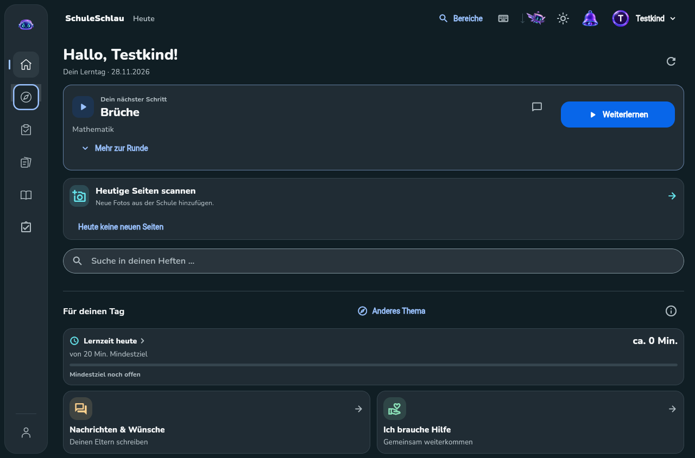

# Desktop-Navigation: Tastaturprüfung vom 25.11.2026

Die eingeklappte Seitenleiste wurde im echten Chrome-Webrunner bei
1280 × 844 Pixeln mit einem künstlichen Kinderkonto auf einem isolierten
lokalen Testserver geprüft. Der bisherige Test suchte eine Schaltfläche mit
exakt dem Namen „Lernen“. Flutter ergänzt in dieser Darstellung die Position
„Tab 2 of 6“; ein Koordinatenklick war deshalb fälschlich als notwendiger
Ersatz dokumentiert worden. Im tatsächlichen Semantikbaum ist das Ziel als
Schaltfläche mit Tabindex und aktuellem Auswahlzustand vorhanden.

Der erweiterte Mehrtageslauf erreicht das Element mit der Tab-Taste, überprüft
Rolle und Auswahlzustand und öffnet die Fachübersicht mit Enter. Die
Fokusanzeige wurde sichtbar kontrolliert. Der Test vergleicht zusätzlich die
vorher und nachher tatsächlich gerenderten Pixel innerhalb des Elements und
prüft einen Kontrast von mindestens 3:1 gegen den Hintergrund. Im
abschließenden Lauf betrug der gemessene Kontrast 7,84:1; berücksichtigt
wurden nur ausreichend häufige veränderte Pixel, keine einzelnen
Antialiasing-Pixel.

Dies ist ein begrenzter Browser- und Tastaturnachweis, kein Test einer
konkreten Screenreader-Software. Die Ausgabe „Tab 2 of 6“ und die Prüfung
weiterer Navigationsziele, Bildschirmgrößen und Android-Bedienhilfen bleiben
separat zu beurteilen. Der Test verwendet keine echten Kinderinhalte und
keinen externen KI-Anbieter.
