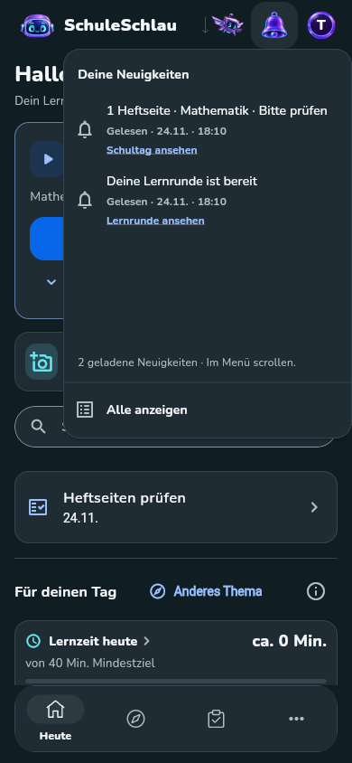

# Benachrichtigungen: unabhängige Webclients

Am 24.11.2026 wurde ein wiederholbarer Ende-zu-Ende-Test für die Glocke,
Lesebelege und die Navigation zur gespeicherten Lernrunde ergänzt. Er startet
ein lokales FastAPI-Backend mit isolierter SQLite-Datenbank und bedient den
Flutter-Webbuild über vier getrennte Chrome-Kontexte bei 390 × 844 Pixeln.
Die Familie, alle Inhalte und die gespeicherte Runde sind künstliche
Testdaten. Die Browser dürfen nur das lokale Testbackend erreichen.

Der Ablauf prüft:

- 60 Nachrichten mit Cursor-Fortsetzung: Beim Öffnen werden sichtbare Karten
  gelesen; unerreichte ältere Nachrichten bleiben ungelesen. Das Glockenmenü
  lädt ältere Karten und quittiert beim Scrollen zusätzlich sichtbare Karten.
- Die Karte „Deine Lernrunde ist bereit“ öffnet die tatsächlich gespeicherte
  Runde. Eine andere Familie darf weder deren Einheit abrufen noch die
  Benachrichtigung quittieren.
- Zwei unabhängig angemeldete Sitzungen desselben Elternkontos sehen denselben
  Lesestand; ein anderes berechtigtes Familienmitglied behält seinen eigenen.
  Auch die Gesamtansicht quittiert beim Scrollen weitere sichtbare Karten.
- Die Lese- und Navigationsvorgänge starten keinen neuen KI-Auftrag. Der
  Test erzeugt keine Pushzustellung und verwendet keine externen KI-Anbieter.
- Eine künstliche Heftseite läuft zuvor über den regulären lokalen
  Vorbereitungspfad mit simulierter Erkennungsantwort bis „Bitte prüfen“.
  Das separat angemeldete Testkind öffnet aus der Glocke sowohl diesen
  Schultag als auch die gespeicherte Lernrunde. Beide Lesebelege gehören zum
  Kind und ändern nicht den Lesestatus des Elternkontos. Während der gesamten
  Browserbedienung entstehen keine weiteren Aufträge, Kostenbuchungen oder
  Pushzustellungen.

Der Test ist über `qa/run_notebook_local_browser.py` im Browser-Gate
eingebunden. Sein Opt-in verweigert vor dem App-Import eine fremde
`TEST_DATABASE_URL`; die Prüfung läuft nur auf einer isolierten SQLite-DB.
Die Benachrichtigungsregression wurde zusätzlich auf SQLite und isoliertem
PostgreSQL ausgeführt.

Die ergänzende Prüfung umfasste 136 erfolgreiche SQLite-Fälle mit zwei dort
ausgelassenen PostgreSQL-Fällen sowie 138 erfolgreiche Fälle auf isoliertem
PostgreSQL. 61 Flutter-Widgetfälle und 20 Fälle im Chrome-Webrunner prüften
unter anderem sichtbare Lesebelege, erneutes Laden, Widerruf und
Sitzungswechsel. Die Transportantworten in diesen Backendtests sind
synthetisch; die sichtbare Android-Zustellung stammt ausschließlich aus den
früheren, gesondert dokumentierten Emulatorläufen.

Ein ergänzender künstlicher Timeout beim Pushversand bleibt als fehlgeschlagene
Zustellung vermerkt. Wiederholtes Einreihen erzeugt keinen zweiten Versand;
die In-App-Meldung und die berechtigte Lernrunde bleiben erreichbar. Dieser
Fehlerfall bestand auf SQLite und isoliertem PostgreSQL. Er simuliert FCM und
ist kein Nachweis einer tatsächlichen Netzstörung oder nativen Zustellung.

Ein ergänzender Versuch mit der installierten, anhand des APK-Hashes
verifizierten produktiven Android-Version 1.38.149+304 auf einem Emulator
konnte wegen wiederholter Hänger der Android-Systemoberfläche unter hoher
VM-Last nicht abgeschlossen werden. Das ausschließlich dafür angelegte
künstliche Konto wurde gelöscht. Daher belegt dieser Lauf weder einen nativen
Gerätewechsel noch FCM-Annahme oder sichtbare Pushzustellung. Die früheren
separaten Pushnachweise behalten ihren jeweils dokumentierten Versions- und
Geräteumfang. Die funktionale Gesamtprüfung kombiniert diese früheren
Emulatorbeobachtungen mit den oben beschriebenen aktuellen lokalen Fällen;
eine erneute native Prüfung des aktuellen Stands bleibt separat offen.
